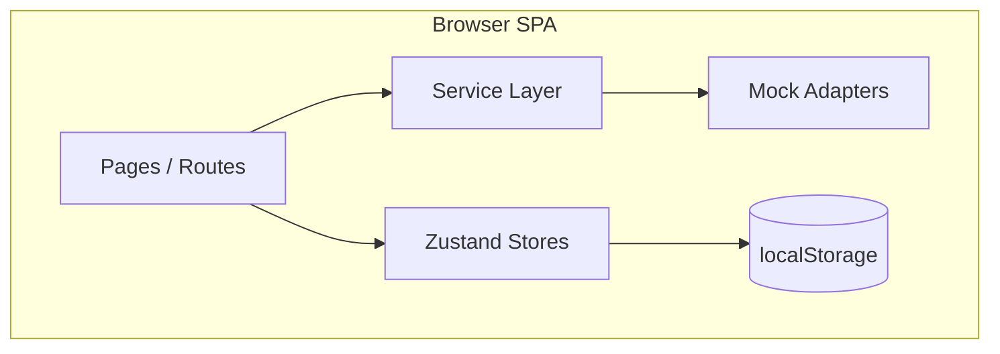
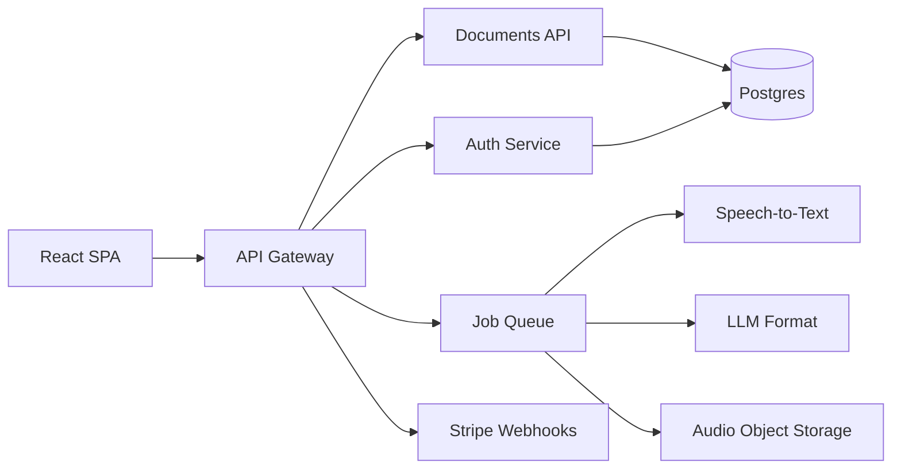
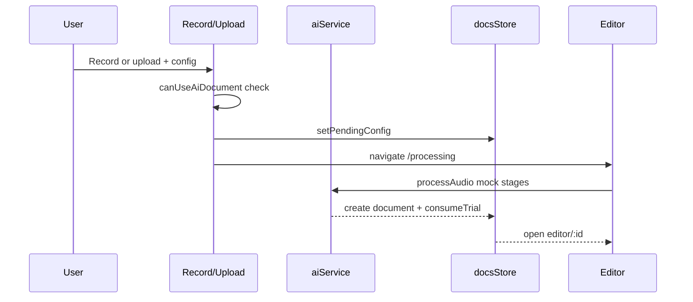

# Voice2Doc AI — Architecture

This document describes how the app is organized today (frontend demo) and how to grow it into a multi-tenant SaaS.

---

## 1. High-level system (today)



- **No backend required** for the demo.
- Services return mock data with realistic delays so UI can later call the same interfaces over HTTP.

---

## 2. Target system (upscale)



| Component | Suggested stack |
|-----------|-----------------|
| API | Node (Nest/Fastify) or Python (FastAPI) |
| Auth | Clerk, Auth0, or Supabase Auth |
| DB | PostgreSQL |
| Queue | Redis + BullMQ / SQS |
| STT | Whisper API / Deepgram |
| LLM | OpenAI / Anthropic |
| Files | S3 / R2 |
| Billing | Stripe Checkout + Customer Portal |

---

## 3. Frontend module map

| Path | Responsibility |
|------|----------------|
| `src/pages/*` | Route-level screens; orchestration only |
| `src/components/*` | Reusable UI (AppShell, GlassCard, Waveform…) |
| `src/store/*` | Client state + persistence (auth, settings, docs/usage) |
| `src/services/*` | Side effects & remote I/O contracts |
| `src/config/*` | Env, plans, feature flags (single source of truth) |
| `src/lib/*` | Pure helpers: types, mock generation, trial math |

**Rule of thumb:** pages talk to stores + services; services own async work; config owns product rules (limits, plan perks).

---

## 4. Core user flows

### 4.1 Auth (demo)

```
Register/Login → useAuthStore → persist → ProtectedRoute → /app
```

Upscale: replace store login with `authService.login()` → JWT/session cookie → hydrate user + plan from API.

### 4.2 Voice → Document



Free plan: `trialsUsed < FREE_DOCUMENT_LIMIT` (10). Paid plans skip consumption checks for unlimited.

### 4.3 Billing (demo)

Plan lives in `useSettingsStore.plan`. Choosing Pro/Business unlocks unlimited AI docs immediately in the client.

Upscale: Stripe Checkout → webhook sets `users.plan` → SPA refetches entitlements.

---

## 5. Entitlements model

Centralized in `src/config/plans.ts`:

| Plan | AI documents | Notes |
|------|--------------|-------|
| Free | 10 lifetime (demo) | Enforce on server in production |
| Pro | Unlimited | Premium AI flags |
| Business | Unlimited | Team / API flags (future) |

Helpers: `src/lib/trials.ts` → `canUseAiDocument`, `trialsRemaining`.

**Production rule:** never trust the client for `trialsUsed`. Increment in a transaction after a successful job:

```sql
UPDATE users
SET trials_used = trials_used + 1
WHERE id = $1 AND plan = 'free' AND trials_used < trials_limit
RETURNING *;
```

If `RETURNING` is empty → return `402 Payment Required`.

---

## 6. Suggested database sketch

```text
users
  id, email, name, plan, trials_used, trials_limit, created_at

documents
  id, user_id, title, type, content, tone, language, favorite, created_at, updated_at

audio_assets
  id, user_id, storage_key, duration_sec, mime, created_at

jobs
  id, user_id, audio_id, status, stage, document_id, error, created_at, finished_at

subscriptions
  id, user_id, stripe_customer_id, stripe_sub_id, status, plan, current_period_end
```

---

## 7. Service layer contracts

Located under `src/services/`:

| Module | Methods (illustrative) |
|--------|------------------------|
| `authService` | `login`, `register`, `logout`, `getSession` |
| `documentService` | `list`, `get`, `create`, `update`, `remove` |
| `aiService` | `enqueueProcess`, `getJobStatus`, `transformText` |
| `billingService` | `getEntitlements`, `createCheckoutSession` |

Toggle via `VITE_USE_MOCK_API` in `.env`. When `false`, adapters should call `VITE_API_BASE_URL`.

---

## 8. Phased roadmap

### Phase 0 — Demo (complete)
- Full UX, mock AI, local entitlements

### Phase 1 — Real accounts (complete)
- Express API + SQLite + JWT
- Server-enforced free trial (`trials_used`)
- Documents CRUD + billing plan row
- Frontend: `VITE_USE_MOCK_API=false`

### Phase 2 — Real pipeline (complete)
- Multipart audio upload to `server/uploads`
- `jobs` + `audio_assets` tables; async worker
- Stages: Uploading → Transcribing → Understanding → Formatting → Finalizing
- Optional `OPENAI_API_KEY` for Whisper + GPT; otherwise mock STT/LLM with real job flow
- Client polls `GET /api/ai/jobs/:id`

### Phase 3 — Monetization (complete)
- Stripe Checkout for Pro/Business when `STRIPE_SECRET_KEY` + price IDs are set
- Webhook `POST /api/billing/webhook` syncs plan from subscription events
- Customer portal (`POST /api/billing/portal`)
- Without Stripe keys: local plan switch (dev/demo fallback)
- Success/cancel return URLs → `/app/billing?checkout=…`

### Phase 4 — Teams (complete)
- Workspaces with roles: owner / admin / member
- Invite by registered email; share documents into a workspace
- Document list includes personal + shared workspace docs
- Admin snapshot (member/doc counts) for owners & admins
- Create workspace requires Pro or Business plan

### Phase 5 — Integrations (complete)
- Providers: Zoom, Google Meet, Microsoft Teams, Notion, Google Docs
- Connect/disconnect (demo mode without vendor OAuth keys)
- OAuth redirect flow when client IDs/secrets are configured
- Import meeting → creates Meeting Notes draft
- Export document → Notion / Google Docs (demo URL or live Notion with `NOTION_INTERNAL_TOKEN`)
- UI: `/app/integrations` + editor Export menu

### Phase 6 — Localization & Studio Personalization (complete)
**Unique product angle:** a “Studio Atelier” — users do not merely toggle dark mode; they compose a personal glass studio (accent + type + language) that re-skins the entire product, including marketing pages.

| Capability | Detail |
|------------|--------|
| Locales | `i18next` + `react-i18next`; catalogs `en`/`es`/`fr`/`de`/`ur`/`ar` under `src/i18n/locales/` |
| RTL | Urdu & Arabic set `html[dir=rtl]` + `lang` via `applyStudioTheme` (synced with `i18n.changeLanguage`) |
| Accent atelier | 6 curated palettes → CSS `--color-accent`, `--color-signal`, `--studio-*-rgb` |
| Typography | 6 display/body pairs → `--font-display`, `--font-sans` |
| Persistence | Zustand `v2d-settings` + `users.preferences_json` via `GET/PUT /api/preferences` |
| Surfaces wired | Public header/footer, landing hero, auth, app shell nav, Settings atelier |

### Phase 7 — Meeting Memory Graph (complete)
Cross-meeting knowledge graph unique to Voice2Doc:

- Speaker diarization labels on transcript segments (`Speaker: …` parsing)
- Action-item extraction with owner + due-date candidates
- Decision fingerprints merge recurring topics across Zoom/Meet/Teams imports
- UI: `/app/memory` thread list + detail (linked meetings, actions, resolve)
- Tables: `memory_meetings`, `memory_speakers`, `memory_segments`, `memory_threads`, `memory_thread_links`, `memory_actions`
- API: `GET/PATCH /api/memory/threads`, `GET /api/memory/meetings`, `POST /api/memory/ingest`
- Import meeting (Phase 5) auto-ingests a memory meeting
- Unit tests: `src/lib/memoryGraph.test.ts`, `server/src/lib/memoryGraph.test.ts`, `src/theme/theme.test.ts` (`npm test`)

### Phase 8 — Document Atelier (complete)
Turn exports into brand-faithful artifacts:

- Per-user **brand kits** (logo text, accent, letterhead title, footer)
- **Tone DNA** profiles with do/don’t lists + sample openings → prompt fragments
- Live preview via `POST /api/atelier/preview` (letterhead wrap + tone fit score)
- UI: `/app/atelier`
- Tables: `brand_kits`, `tone_profiles`
- Unit tests: `src/lib/atelier.test.ts`

### Voice Guide (cross-cutting demo UX)
- Floating headphones control on public + app shells
- Browser Speech Synthesis narrates guided tours (welcome, record, memory, settings, atelier, help)
- No vendor TTS keys required; language hint follows Phase 6 locale

### Phase 9 — Live Studio Collab (complete)
Collaboration anchored to *voice time*, not just document paragraphs:

- Presence avatars in the editor (WebSocket `/ws/collab` + REST heartbeat)
- Modes: editing / listening (listen-along) / recording
- Comments pinned to transcript timestamps (`m:ss`) and mirrored into doc HTML
- Conflict-safe saves via `baseUpdatedAt` / `revision` → HTTP 409 on stale write
- Table: `doc_comments`; documents gain `revision` column
- API: `CRUD /api/documents/:id/comments`, `POST .../presence`
- UI: `CollabPanel` on editor page
- Unit tests: `src/lib/collab.test.ts`

### Phase 10 — Trust & Compliance Vault (complete)
Enterprise trust without losing Studio Glass clarity:

- Retention policies (purge audio after N days; keep docs toggle)
- Immutable audit log (exports, imports, preference + policy changes)
- Region / residency hint (`local` | `us` | `eu` | `apac`)
- Data export JSON + content wipe (account retained)
- Tables: `audit_log`, `compliance_policies`
- API: `GET/PUT /api/compliance/policy`, `GET /api/compliance/audit`, `POST /purge-audio|export|wipe`
- UI: `/app/compliance`
- Plans: Free / Pro / Business / **Enterprise** (Trust Vault + residency)
- Unit tests: `src/lib/compliance.test.ts`

### Phase 11 — Studio AI Chatbot (current)
An in-product assistant that lives in the Studio Glass shell — not a generic widget:

- Floating studio chat with accent/typography inherited from Phase 6 preferences (`StudioChatbot` in app shell)
- Context modes: **Help** (product FAQs), **Document** (focused doc hints), **Meeting** (summaries from Memory threads)
- Supports JSON replies and SSE typing stream (`?stream=1`)
- Optional tool-like flows: guide to editor export, billing upgrade, memory follow-up
- Respects privacy analytics toggle: chat still works, but history is not persisted when analytics are off
- Tables: `chat_sessions`, `chat_messages`
- API: `GET/POST /api/chat/sessions`, `GET /api/chat/sessions/:id/messages`, `POST /api/chat/sessions/:id/messages`

### Phase 12 — Echo Score (planned)
Measure how much spoken intent survived into the finished document:

- Diff spoken transcript vs final draft; surface “lost phrases”
- Score 0–100 with tips to restore missing commitments/action items
- Hook into job finalization + editor sidebar

### Phase 13 — Voice Twin (planned)
Learn a personal writing voice from past documents and apply as living Tone DNA:

- Train from selected docs / Memory decisions
- One-click “sound like me” on AI assist
- Versioned twins per workspace

### Phase 14 — Speak-the-UI (planned)
Expand Voice Guide into voice-controlled navigation:

- “Open Memory”, “Start recording”, “Export to Notion”
- Locale-aware speech recognition + confirmation toasts
- Respect compliance audit for voice commands

### Public legal & support surfaces
- `/privacy` — Privacy Policy (collection, audio, integrations, rights)
- `/help` — Help Center (topics + FAQ, including Phase 11 chatbot preview note)

---

## 9. Non-functional targets (when upscaling)

| Area | Target |
|------|--------|
| API latency (non-AI) | p95 &lt; 300ms |
| Job feedback | Stage updates ≤ 2s |
| Security | Auth on every mutation; signed upload URLs |
| Observability | Request IDs, job traces, error tracking |
| Cost control | Cap concurrent jobs per free user |

---

## 10. Design constraints to keep

- Studio Glass identity (not generic purple SaaS)
- One primary action per screen
- Honest stubs (e.g. PDF export toast) until real exporters ship
- Phase 6 accents stay warm/neutral (amber, teal, clay, brass, sage, copper) — never default purple glow
